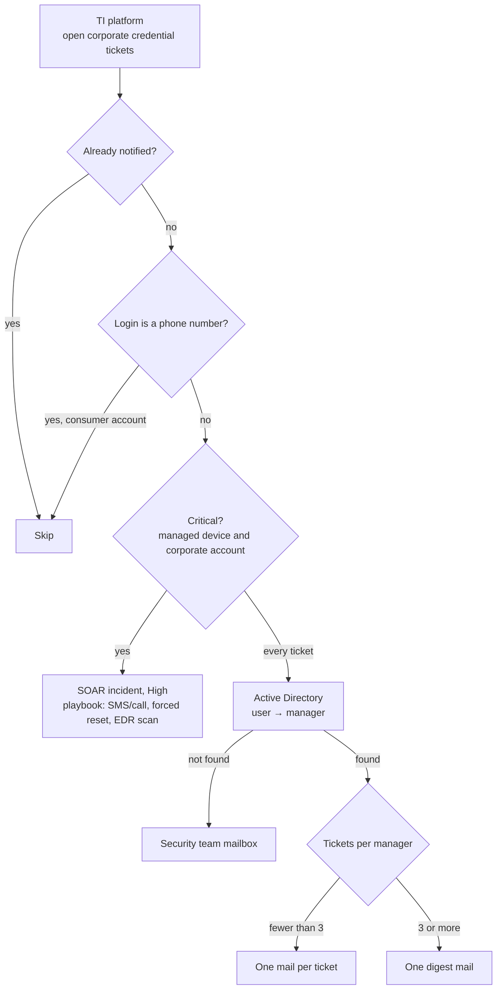

# Threat Intelligence Platform Integration: Credential Leak Notifier

[](https://github.com/AtakanUk/threat-intel-platform-integration/actions/workflows/ci.yml)

[](LICENSE)

Turns compromised-credential tickets from a threat-intelligence platform into actions inside the company. When employee credentials show up in info-stealer logs or underground markets, the platform opens a ticket. This service makes sure the right person, the employee's line manager, hears about it the same day, and that the dangerous cases become SOAR incidents.

## Flow



## Details

- **Directory lookup**: the leaked login is tried as `sAMAccountName`, UPN and mail, then as a fuzzy `sAMAccountName`/`displayName` match, and finally without the privileged-account suffix (`_ca` / `-ca`). Each attempt runs over several search bases, a narrow OU first and the domain root as fallback. All user input is LDAP-escaped. If the manager's DN can't be read (for example because the object moved), the manager is searched by name. One LDAP connection serves the whole run.
- **Delivery guarantee**: a ticket is marked as processed only after its mail was sent. When SMTP fails, the ticket is simply retried on the next run, and one failing recipient does not stop the others. The state file is written atomically.
- **Noise control**: managers with many affected users get one digest instead of a mail per ticket. Consumer logins that look like phone numbers are skipped.
- **Safe rollout**: `DRY_RUN=true` only logs. `TEST_RECIPIENT` sends every mail to one address, with the real recipient in the subject, for a pilot phase.

## Usage

```bash
pip install -e .
cp .env.example .env
credential-leak-notifier                 # or: python -m threat_intel_platform_integration
credential-leak-notifier --status in_progress --log-level DEBUG
```

Typical schedule: every 30 minutes from cron. The exit code is `1` if any mail failed.

## Configuration

All settings are environment variables. `.env.example` documents each one. The main groups are:

| Group | Variables |
| --- | --- |
| Platform | `THREAT_INTEL_BASE_URL`, `THREAT_INTEL_API_TOKEN`, `THREAT_INTEL_AUTH_SCHEME`, proxies, `TICKET_STATUS`, `CORPORATE_ONLY` |
| Processing | `BATCH_THRESHOLD`, `SKIP_PHONE_USERNAMES`, `FALLBACK_MANAGER_EMAIL`, `STATE_FILE` |
| Mail | `SMTP_*`, `DRY_RUN`, `TEST_RECIPIENT` |
| Directory | `LDAP_SERVER`, `LDAP_PORT`, `LDAP_USE_SSL`, `LDAP_USER_DN`, `LDAP_PASSWORD`, `LDAP_SEARCH_BASES` |
| Critical cases | `CRITICAL_DEVICE_PATTERN`, `CRITICAL_USERNAME_PATTERN`, `SOAR_*` |

## Tests

```bash
pip install pytest
pytest
```

The tests cover filtering, batching, the fallback recipient, the retry-after-failure behaviour, the critical-case rule, API pagination, LDAP filter escaping, and manager resolution against ldap3's in-memory mock directory.

## License

[MIT](LICENSE)
